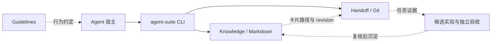

# Agent Suite

本地 Agent 工具套件：按需检索知识、保留跨会话现场、用实际任务结果改进规则。模型负责判断；确定性代码负责存储、版本、比较与恢复。

[快速入门](docs/00-quickstart.md) · [架构](docs/architecture.md) · [实验工作流](docs/experiments.md) · [更新记录](#更新记录) · [Releases](https://github.com/Choysang/agent-suite/releases)

## 架构



| 模块 | 职责 |
|---|---|
| [统一入口](src/) | 安装、版本、诊断、命令转发；不复制领域逻辑 |
| [Knowledge](knowledge/) | 5 个 Skills、分项检索、版本绑定反馈、可靠写入、候选实验 |
| [Handoff](handoff/) | Git 封存、原话引用、并行 lane、认领、汇合与本地只读看板 |
| [Guidelines](guidelines/) | 区分用户目标与解法建议，核验证据，按结果交付 |

核心不绑定具体模型、模型 API 或调度框架。更强的宿主可沿同一契约选择工具和并行任务；知识库与交接记录继续独立可读。卡片与原始证据留在个人 vault，公开仓库只保存实现和模板。

## 快速开始

需要 Node.js 24+、Python 3.11+、PyYAML 和 Git。先准备已有知识库；空目录按 [BOOTSTRAP](knowledge/BOOTSTRAP.md) 初始化。

```sh
git clone https://github.com/Choysang/agent-suite.git
cd agent-suite
python -m pip install "PyYAML>=6"
npm link
agent-suite install --vault "<知识库绝对路径>" --agents codex,claude,workbuddy,codebuddy --guidelines
agent-suite doctor
agent-suite config --json
agent-suite kb find "当前任务的知识需求"
agent-suite handoff --help
```

安装将五个 vault Skills 链接到源码，再连接到宿主 Skills；旧目录留备份，不改个人卡片或 taxonomy。`--guidelines` 维护 Codex/Claude Code 的标记区，保留其余文字；WorkBuddy/CodeBuddy 当前只安装 Skills。仅想预览时加 `--dry-run`。配置位置为 `~/.agent-suite/config.json`。

三个领域模块仍可独立使用。全套源码与各模块的下载包见 [Releases](https://github.com/Choysang/agent-suite/releases)；main 与最新下载包可能不是同一版本。

## 经验如何形成改进

先查库并记录实际采用的 revision，在任务中保留错误及纠偏证据；观察到结果后反馈、沉淀、校验、重建路由。要升级成规则或脚本时，用 `kb experiment init/record/report` 冻结单项改动，在分开的开发与验收任务上比较质量和成本。命中不等于采用，分数不等于真伪，测试通过也不代表模型任务收益。详见 [RSI](knowledge/RSI.md)。

## 验证

```sh
npm ci
npm ci --prefix handoff
python -m pip install PyYAML pytest
npm run verify
```

统一验证覆盖安装回退、知识写入与实验记录、handoff 回归、TypeScript 类型和模板检查。CI 使用 Windows 与 Linux。宿主实际加载、hook 触发和长期任务收益需要分别观察，`doctor` 不会把文件存在报告成这些行为已经成功。

## 更新记录

日期倒序记录实际变化。版本号表示源码版本；下载包在对应 Release 发布后更新。

| 日期 | 版本 / 状态 | 模块与实际变化 | 记录 |
|---|---|---|---|
| 2026-10-26 | 1.2.0 源码与本机集成，尚未打包发布 | 统一宿主目录解析；指南托管选择持久化与漂移检查；跨项目读取 vault 配置；跨盘目录备份与物理目录别名去重；fork 写入范围冲突校验与失效工作区恢复检查；修复人工隔离和反馈幂等重试；补研究机制与工程边界。 | [验证](docs/validation-1.2.md) · [研究落点](docs/research-to-architecture.md) |
| 2026-10-18 | 1.2.0 源码升级 | 统一安装/诊断/命令入口；知识引擎模块化、排他写入与失败恢复；新增冻结候选和成对实验记录；修复接力与看板；指南核验目标与解法建议；补 Windows/Linux CI。 | [架构](docs/architecture.md) · [实验](docs/experiments.md) · [维护](docs/maintenance.md) |
| 2026-10-17 | main，尚未打包发布 | **工作指南与首页**：更新 Codex、Claude 与通用版英文指南，强化前提核验、最小必要复杂度和可观察结果；通用中文版增加极简提示；首页补充模块、安装与工作流介绍。本轮进一步改为可追溯的版本记录。 | [指南更新提交](https://github.com/Choysang/agent-suite/commit/55793c9) |
| 2026-10-17 | **[v1.1.0](https://github.com/Choysang/agent-suite/releases/tag/v1.1.0)** | **知识库**：分项检索、精简读取、版本绑定反馈、反例隔离和正文预算；增加保留原文的全库整理规则。**handoff 协议 v2**：新增可选知识引用与摩擦记录，兼容旧草稿。**工作指南**：接入三阶段经验反馈入口。 | [设计取舍](docs/rsi-design.md) · [整理方法](docs/knowledge-curation.md) · [验证记录](docs/rsi-validation.md) |
| 2026-10-10 | **[v1.0.1](https://github.com/Choysang/agent-suite/releases/tag/v1.0.1)** | **handoff**：修复 Git 子进程提前关闭 stdin 时的错误传播，以及无输入命令的空写入问题。 | [版本差异](https://github.com/Choysang/agent-suite/compare/v1.0.0...v1.0.1) |
| 2026-10-10 | **[v1.0.0](https://github.com/Choysang/agent-suite/releases/tag/v1.0.0)** | **仓库与发布**：合并工作指南、知识库和 handoff，保留原项目历史，提供三个独立下载包；handoff 已包含并行车道、汇合和本地看板。 | [迁移与维护](docs/maintenance.md) |


历史发布 v1.1.0 的验证为知识库 40 项、handoff 28 项测试及类型检查通过。当前版本以 `npm run verify` 和 CI 输出为准，不将回归测试数量解释为智能提升。全部变更见 [Git 历史](https://github.com/Choysang/agent-suite/commits/main/)。

MIT · [维护与升级](docs/maintenance.md)
