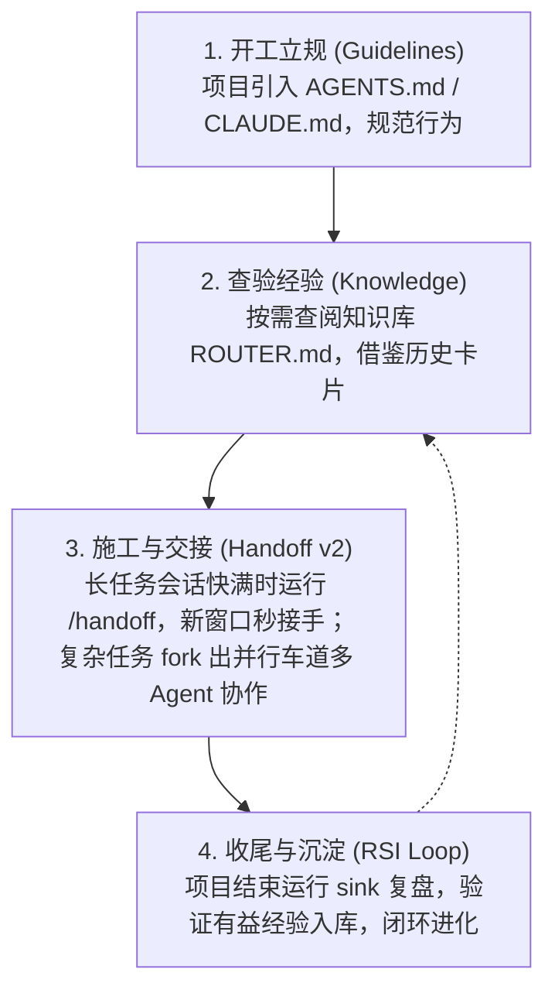

# Agent Suite

> **让 Agent 立规矩、记经验、传接力。**  
> 一套专为现代 AI 辅助研发（AI Coding & Agentic Engineering）打造的开箱即用套件。解决大模型「瞎猜瞎改、随手遗忘、长任务上下文断连」三大痛点。

[English Overview](README.en.md) · [快速入门](docs/00-quickstart.md) · [独立下载 Releases](https://github.com/Choysang/agent-suite/releases/latest)

---

## 💡 为什么需要 Agent Suite？

你在用 Claude Code、Codex、Cursor、Windsurf 等 AI 工具编程时，是否经常遇到这些困扰？

1. **AI 瞎附和、爱走捷径**：提一个有漏洞的想法，AI 盲目执行；或者为了修复一个小 Bug，顺手把无关代码大改一通，甚至伪造测试报告。  
   👉 **我们需要「工作指南 (Guidelines)」**：给 Agent 立下不可逾越的行为底线。
2. **今天踩的坑，明天全忘了**：好不容易调通的环境或避开的深坑，新起一个会话，AI 又重新踩一遍；搜集的好文章、好工具散落各处无法形成复用资产。  
   👉 **我们需要「知识库与经验闭环 (Knowledge & RSI)」**：给 Agent 打造带反馈验证机制的“第二大脑”。
3. **任务太长，上下文一满就抓瞎**：大型重构或多步任务做到一半，Token 爆炸只能新开窗口，但新 AI 根本不知道刚才做了什么、改了哪里、下一步是什么。  
   👉 **我们需要「会话交接 (Handoff v2)」**：像接力赛一样无损传递战场现场，还支持开辟并行车道多人协同。

---

## 🧩 三大核心模块总览

每个模块既能**完全独立使用**（按需取用），也能**无缝组合**形成工程闭环。

```
┌────────────────────────────────────────────────────────────────────────┐
│                              AGENT SUITE                               │
│                                                                        │
│   ┌──────────────────┐   ┌──────────────────┐   ┌──────────────────┐   │
│   │   工作指南       │   │   知识库与闭环   │   │   会话交接       │   │
│   │   Guidelines     │   │   Knowledge (RSI)│   │   Handoff v2     │   │
│   ├──────────────────┤   ├──────────────────┤   ├──────────────────┤   │
│   │ • 独立判断与依据 │   │ • 5 大日常 Skill │   │ • 状态/现场封存  │   │
│   │ • 极简与精准改动 │   │ • 分层按需路由   │   │ • 多车道并行汇合 │   │
│   │ • 实测检验再报告 │   │ • RSI 受控闭环   │   │ • A2A 协议/看板  │   │
│   │ • Token 极致优化 │   │ • Markdown/黑曜石│   │ • 零运行时依赖   │   │
│   └────────┬─────────┘   └────────┬─────────┘   └────────┬─────────┘   │
│            └──────────────────────┼──────────────────────┘             │
│                                   ▼                                    │
│                    形成「立规 ➜ 查验 ➜ 推进 ➜ 沉淀」闭环               │
└────────────────────────────────────────────────────────────────────────┘
```

| 模块 | 核心能力与解决的问题 | 适用工具与形式 | 单独下载 |
|---|---|---|---|
| [**工作指南**](guidelines/) | **给 Agent 立规矩**：核对前提、不盲从附和、极简实现、精准改动、实事求是。提供 Codex 版、Claude 版、通用完整版与极简版。 | 文本规则（`AGENTS.md` / `CLAUDE.md` / 系统偏好） | [guidelines.zip](https://github.com/Choysang/agent-suite/releases/latest/download/guidelines.zip) |
| [**知识库 (RSI)**](knowledge/) | **给 Agent 装上第二大脑**：收资料 (`capture`)、记经验 (`sink`)、按需查库 (`kb`)、待办与日志 (`daily`)、定期治理 (`tidy`)，支持实战反馈与防污染。 | 5 个 Agent Skills + Python 检索与治理引擎（可配合 Obsidian） | [knowledge.zip](https://github.com/Choysang/agent-suite/releases/latest/download/knowledge.zip) |
| [**会话交接 v2**](handoff/) | **长任务接力与多车道并行**：单线交接 (`relay`)、多分支车道并行 (`fork`/`take`/`join`)、A2A 认知看板 (`handoff ui`)，原话/Git 快照全保留。 | CLI 命令行工具 + Agent Skill（Node.js 24+，无外部依赖） | [handoff.zip](https://github.com/Choysang/agent-suite/releases/latest/download/handoff.zip) |

---

## 🚀 近期重要版本改动（相比两个版本前）

如果你的认知还停留在早期版本，套件已经历了重大的工程升级：

### 1. 会话交接协议升级至 v2（支持多车道并行与认知看板）
- **从单线接力升级为 DAG 网格**：支持长任务一分为多（`fork`），利用 Git Worktree 开启多条并行车道让多个 Agent 同时推进独立模块，完成后统一汇聚（`join`）。
- **A2A (Agent-to-Agent v1.0) 支持与本地 Web UI**：内置轻量本地服务器，运行 `handoff ui` 即可在浏览器直观查阅会话交接的 DAG 关系树图与任务状态。
- **更可靠的 Git 进程管线**：完善了子进程早期退出时的 Stdin 保护，不再丢失错误诊断信息。

### 2. 知识库闭环体验改进（RSI Loop）
- **分项补缺检索 (`kb find --need`)**：对于复杂任务，支持按明确知识需求提取分项候选，避免漏掉关键前置条件。
- **采信追踪与防污染反馈**：卡片阅读明确记录版本 Revision 与 Task ID（单纯检索命中不等于采信）；执行中记录摩擦与错误假设，阶段完成后由真实结果打分，隔离失效经验，保护知识库的纯净度。
- **正文预算控制**：对卡片设置最大字数/行数预算，确保检索注入不会撑爆 Agent 上下文。

### 3. 工作指南重塑与极简版（Token-Optimized）
- **行事原则全线收紧**：全面重构了 Codex 与 Claude Code 的指导原则，强化「独立判断、证据优先、极简优先、精准修改」。
- **新增通用极简版**：针对系统提示词字符受限、或者对 Token 消耗极度敏感的场景，提炼出 5 段式极简指令（Judgment / Execution / Verification / Knowledge），直击核心要害。

---

## 🔄 三个模块如何协同作战？（典型实战工作流）

一个完整的项目研发周期通常只需 4 步：



1. **开工立规**：在项目根目录放置一份 [工作指南](guidelines/)（如 `AGENTS.md`），告诉 AI：“不许盲目瞎改，不确定的东西要核实，改完要运行最小验证”。
2. **查验经验**：开始编码前，Agent 自动根据需求匹配 [知识库](knowledge/) 的 `ROUTER.md`，只调出真正相关的几条经验，少走弯路。
3. **施工推进与交接**：
   - 任务太长、对话上下文发红时，输入 `/handoff` 生成封存包；在下一个新窗口输入 `/handoff 7`，新 Agent 立即在最新的代码现场继续。
   - 需要前后端同时开工时，使用 `fork` 划分独立车道并行执行，最后用 `join` 汇合。
4. **收尾与沉淀**：任务圆满结束后，通过 `sink` 或 `sink 复盘` 将本次踩坑的解决方案提炼为卡片，经由 `RSI` 评估机制沉淀为下一阶段的资产。

---

## 🛠️ 快速上手

### 选项 A：我只想让 Agent 变靠谱（零安装，仅复制文本）
1. 进入 [guidelines/](guidelines/) 目录；
2. 如果使用 **Codex**，将 [codex/AGENTS.md](guidelines/codex/AGENTS.md) 放入项目根目录；
3. 如果使用 **Claude Code**，将 [universal/AGENTS.md](guidelines/universal/AGENTS.md) 放入项目根目录的 `CLAUDE.md`；
4. 如果使用 **Claude 聊天版**，将 [claude/INSTRUCTIONS.md](guidelines/claude/INSTRUCTIONS.md) 粘贴到网页端的个人指令（Custom Instructions）中；
5. 如果 Token 预算紧张，直接使用通用精简版。

### 选项 B：我想搭建一套越用越聪明的知识库
1. 单独下载 [knowledge.zip](https://github.com/Choysang/agent-suite/releases/latest/download/knowledge.zip) 并解压；
2. 准备一个存放个人笔记的空目录（例如 `D:/MyVault`），环境需 **Python 3.11+**；
3. 对你的 AI Agent 发送：
   ```text
   安装资料在 <解压出的 knowledge 路径>，
   我的知识库在 <准备好的空目录路径>。
   请读取安装资料里的 BOOTSTRAP.md，按流程帮我搭建知识库。
   ```
4. Agent 会自动配置分类、模板与 5 个技能（`capture`, `sink`, `kb`, `daily`, `tidy`），并生成首期索引 `ROUTER.md`。

### 选项 C：我经常做大项目，换会话就要丢失进度
1. 单独下载 [handoff.zip](https://github.com/Choysang/agent-suite/releases/latest/download/handoff.zip) 并解压，环境需 **Node.js 24+** 与 **Git**；
2. 在解压目录执行全局链接：
   ```bash
   npm link
   handoff install
   ```
3. 在你的任何 Git 项目仓库中：
   - 当前会话封存：在 Claude Code 输入 `/handoff`，在 Codex 输入 `$handoff`；
   - 开启新窗口接手：输入 `/handoff <编号>`；
   - 查看交接历史与可视化看板：终端运行 `handoff ls` 或 `handoff ui`。

---

## 📂 仓库结构导航

```text
agent-suite/
├── guidelines/            # 模块 1：工作指南与行为规范
│   ├── codex/             # Codex 终端环境配置 (中/英)
│   ├── claude/            # Claude 聊天版个人偏好 (中/英)
│   └── universal/         # Claude Code 及通用 Agent 规范 (含完整版与极简版)
├── knowledge/             # 模块 2：知识库、检索治理引擎与 RSI 闭环
│   ├── .agents/skills/    # 5 大核心 Skill (capture, sink, kb, daily, tidy)
│   ├── Templates/         # 经验、项目档案、工具、资料卡片模板
│   ├── BOOTSTRAP.md       # 引导 Agent 初始化新知识库的标准流水线
│   └── RSI.md             # 受控经验改进协议与反馈治理规范
├── handoff/               # 模块 3：会话交接、车道并行与认知看板 (v2)
│   ├── src/               # 纯原生 TypeScript 实现 (核心/内核/端口/适配器)
│   ├── protocol/          # v2 协议规约 (SPEC.md) 与模板
│   └── skill/             # 供 Agent 执行接力封存的 SKILL.md
└── docs/                  # 深度解析与联合实战文档
    ├── 00-quickstart.md   # 三模块联合使用实战指南
    ├── rsi-design.md      # 经验闭环设计取舍与理论依据
    └── maintenance.md     # 仓库维护与版本发布说明
```

---

## 📄 许可与开源说明

- 本仓库由 `Choysang/agent-working-guidelines`、`Obsidian-Wiki-llm` 与 `handoff` 合并进化而来，原始 Git 提交历史已完整保留。
- 遵循 [MIT License](LICENSE)。欢迎提出 Issue、分享你的 Agent 实践！
