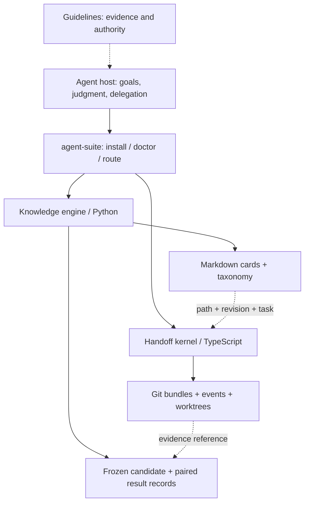

# Architecture

Agent Suite is a local tool layer for an agent host. The host chooses a model,
reasons, requests tools and delegates work. The suite makes knowledge, handoffs and
observed results explicit and inspectable. No model names or model API clients are
embedded in its core.

## Modules and ownership

| Boundary | Responsibility | State |
|---|---|---|
| `src/` | Configure, install links, inspect runtime, forward CLI arguments and exit codes | `~/.agent-suite/config.json` |
| `knowledge/.../kb_engine/` | Retrieve, read, validate, write and evaluate recorded observations | User's vault and project experiment files |
| `handoff/src/core/` | Pure protocol, DAG and state transformations | None |
| `handoff/src/kernel/` | Prepare, seal, recover, claim, reconcile and join | Through declared ports |
| `handoff/src/adapters/` | Git, filesystem and host-session integration | Git objects/refs and local projections |
| `handoff/src/faces/` | CLI, installation and local read-only UI | Presentation only |
| `guidelines/` | Human-readable behavior contracts | Versioned text |

Parallel contributors own disjoint paths. Cross-module integration goes through CLI
and documented JSON, or references to evidence; no module reaches into another
module's mutable private state. A lane records its goal, owned paths, workspace and
acceptance condition. Scheduling and model selection remain host responsibilities.

## Knowledge engine

`kb.py` and `kb_rsi.py` remain compatibility entry points. The implementation lives in:

| Module | Responsibility |
|---|---|
| `model.py` | Card schemas, constants, response records |
| `repository.py` | Markdown parsing, validation, reading, revision-bound feedback |
| `storage.py` | Cooperating-writer locks, exclusive creation, atomic file replacement |
| `search.py` | Lexical BM25 candidates and per-requirement retrieval |
| `routing.py` | Route rendering and projection publication |
| `intake.py` | Source deduplication, card creation, preservation of original clips |
| `governance.py` | Pure revision, feedback and budget calculations |
| `experiment.py` | Frozen candidates and paired comparisons of recorded observations |
| `cli.py` | Arguments, output and exit codes |

Cards are the knowledge state; routes and scores are derived views. Retrieval is a
candidate generator. It does not certify semantic coverage or turn generated context
into evidence. `read` exposes the content revision so adoption and feedback can refer
to the same version. Ordinary retrieval has no write side effect.

All engine writers cooperate through the vault lock. New cards are published
exclusively, IDs are single filenames and globally unique across card kinds. Intake
preserves conflicting raw files and supports retry after interrupted cleanup. Route
generation stages outputs first and restores replaced files on ordinary I/O errors.
This is not an atomic transaction across every file during power loss; routes can be
rebuilt. External editors do not participate in engine locks.

## Improvement loop

1. Retrieve and record the cards actually adopted, with revisions and a stable task ID.
2. Preserve observed errors, corrected hypotheses and original evidence in project state.
3. Distill a small candidate change from accumulated evidence. Freeze its diff, version
   references, metric directions, cost units and separate development/acceptance task IDs.
4. Execute the tasks through the host. Record actual measurements and evidence references.
5. Compare baseline and candidate on the same paired tasks. Report missing data and costs.
   Review generalization, counterexamples and cost before applying a candidate.

`kb experiment` records and calculates; it does not run models, grade evidence, prove
task independence, or promote rules automatically. Prompt effectiveness requires real
task evaluation. Unit tests establish implementation behavior only. See [experiment
commands](experiments.md) and [RSI](../knowledge/RSI.md).

## Deployment

The checkout is the code source. Five vault skill directories link to the checkout;
host skill directories link through the vault. Installation backs up replaced entries,
rolls back completed actions after ordinary failure, and writes configuration last.
Private notes and taxonomy remain in the vault. Managed guideline blocks preserve
surrounding user text; current sessions may need to reload host configuration.

Node.js 24 executes native JavaScript and handoff TypeScript. Python 3.11+ and PyYAML
serve the knowledge engine. No database, daemon, message broker or model SDK is required.
